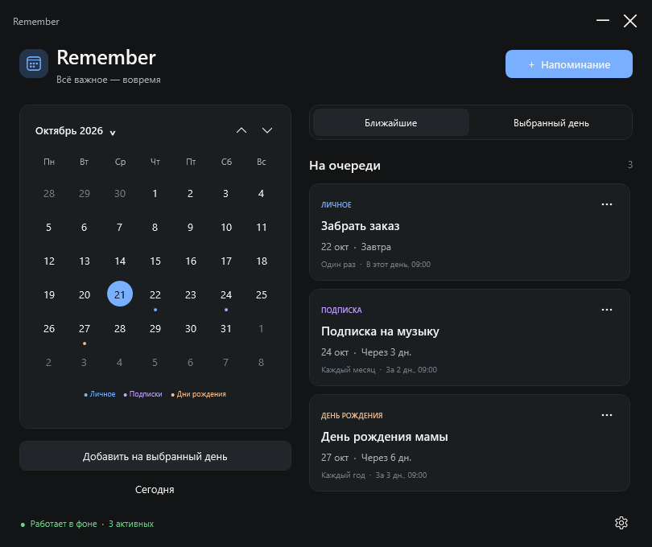
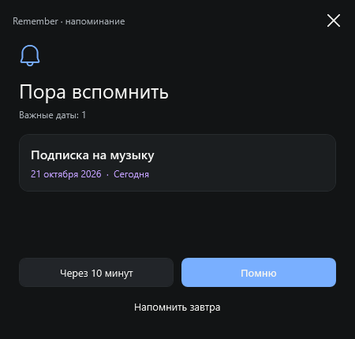

# Remember

Маленький календарь для Windows, который напоминает о подписках, днях рождения и планах. Работает в трее и показывает заметное окно поверх других окон.



## Скачать и запустить

1. Скачайте `Remember-1.0.0-windows.zip` на странице [последнего релиза](https://github.com/Alex-Shadrin/Remember/releases/latest).
2. Распакуйте архив и запустите `Remember.exe`.
3. Нажмите нужный день → **Добавить на выбранный день**. Укажите название, дату, время сигнала и число дней до события. Для подписки включите **Повторять → Каждый месяц**, для дня рождения — **Каждый год**.

Windows 10 (1803+) или Windows 11; используется встроенный .NET Framework 4.7.2 или новее. Установка дополнительной среды обычно не нужна. Программа не подписана цифровым сертификатом.

Для установки с ярлыками на рабочем столе и в меню «Пуск» дважды нажмите **Install.cmd** в распакованной папке. Установка выполняется в `%LOCALAPPDATA%\Programs\Remember`, без прав администратора, и включает автозапуск. Его также можно включить в **Настройках** при обычном запуске EXE. Для переносного запуска оставьте EXE на постоянном месте, если используете автозапуск.

## Что умеет

- Календарь с понедельника, отметками событий и быстрым переходом к месяцу и году по нажатию на заголовок месяца.
- Разовые, ежемесячные, ежегодные и еженедельные события; предупреждение за 0–365 дней в выбранное местное время.
- Отдельное окно поверх остальных: **Помню**, **Через 10 минут**, **Напомнить завтра**. Закрытие сигнала откладывает его на 10 минут.
- Автозапуск в трее; по умолчанию первые сигналы — через две минуты после входа в Windows. Пауза, редактирование, удаление и просмотр завершённых записей.
- Локальные данные, автоматическая резервная копия, экспорт и импорт JSON без замены существующих записей с тем же ID.



## Как работает фон

Закрытие календаря освобождает окно, а значок остаётся в трее. Нажмите на значок, чтобы открыть календарь снова. Полный выход — **Выйти из Remember** в меню значка. `Ctrl+N` создаёт событие, `Esc` закрывает календарь в трей.

Один таймер ждёт ближайшего сигнала или смены дня. Нет сети, опроса сервера, браузерного движка, фоновых анимаций или телеметрии. Основное окно создаётся только при открытии календаря. Во время сна или выключения компьютера Remember не работает; после возобновления он проверяет пропущенные сигналы. Он не будит компьютер.

После длительного перерыва показывается только последнее пропущенное срабатывание каждого повторяющегося события. Подтверждение закрывает именно это срабатывание; следующее остаётся по расписанию. 31-е число приходится на последний день короткого месяца, а затем возвращается на 31-е. Дата 29 февраля в невисокосном году приходится на 28 февраля. Время местное; календарные даты хранятся без часового пояса.

## Данные и удаление

Данные: `%APPDATA%\Remember\reminders.json`, предыдущая версия: `reminders.json.bak`. Запись атомарная. При повреждении основного файла программа сохраняет его отдельно и восстанавливает резервную копию; если восстановление невозможно, сообщает об ошибке, сохраняя исходные файлы. События и заметки не шифруются: защита соответствует доступу к вашему профилю Windows.

Для переноса используйте **Настройки → Экспорт копии / Импорт копии**. Импорт добавляет только отсутствующие ID, настройки не меняет. Экспорт содержит названия и заметки ваших событий.

Чтобы удалить установленное приложение: выйдите через трей и запустите `%LOCALAPPDATA%\Programs\Remember\uninstall.ps1`. Напоминания и резервные копии остаются в `%APPDATA%\Remember`.

## Сборка и проверки

Нужны Windows, Visual Studio 2022 / Build Tools с компонентом **Разработка классических приложений .NET** и targeting pack **.NET Framework 4.7.2**. NuGet-пакеты не используются.

```powershell
# Сборка, проверки дат / хранилища и ZIP релиза
.\scripts\build.ps1 -Test -Package

# Интеграционные проверки настоящих окон (в интерактивной сессии Windows)
.\scripts\build.ps1 -UiTest

# Изолированный ручной запуск: не использует ваши события и не меняет автозапуск
.\bin\Release\Remember.exe --data-dir "$env:TEMP\Remember-sandbox"

# Проверка запуска без календаря, как при входе в Windows
.\bin\Release\Remember.exe --background --data-dir "$env:TEMP\Remember-sandbox"
```

Результат сборки — `bin\Release\Remember.exe`, архив — `dist\Remember-1.0.0-windows.zip`. `scripts/create-icon.ps1` пересоздаёт оригинальный значок из геометрических фигур; готовый значок уже включён в репозиторий.

`src/Core.cs` содержит правила дат, `Storage.cs` — сохранение, `Program.cs` — жизненный цикл, трей и планировщик. `MainWindow.cs`, `Dialogs.cs`, `Ui.cs`, `Theme.xaml` — интерфейс. Проверки покрывают конец месяца, високосные годы, переход года, пропуски, паузу, подтверждение, откладывание, повреждение файла и реальные сценарии редактора / окна сигнала.

Палитра и типографика вдохновлены [Whisperino](https://github.com/Alex-Shadrin/whisperino); реализация интерфейса, значок и код Remember самостоятельные. Технология: C# / WPF / .NET Framework. [Лицензия MIT](LICENSE).

## English

Remember is a tiny offline Windows tray calendar with Russian UI, recurring reminders, configurable advance warnings, a persistent popup, snooze, startup delay, and local JSON backups. Built with C# and the Windows .NET Framework: no Electron, Python, NuGet dependencies, accounts, or network access. Download the ZIP from [Releases](https://github.com/Alex-Shadrin/Remember/releases/latest), extract, and run `Remember.exe`. Optional `install.ps1` creates shortcuts and enables startup without administrator rights. MIT licensed.
