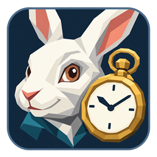

# Remember icon



The Windows executable, desktop / Start menu shortcuts, taskbar and notification-area icon use a close-up rabbit with a pocket watch. The calendar glyph inside the application remains unchanged. The artwork is a raster image in an angular, vector-like style, not an editable SVG.

## Files and reproduction

- `assets/Remember.png`: selected 1254 × 1254 RGBA master, generated with the built-in OpenAI image generation tool, then refined with the same tool.
- `assets/Remember.ico`: PNG-encoded 32-bit frames at 16, 20, 24, 32, 40, 48, 64, 128 and 256 pixels. The executable embeds this file; the installer also copies it for shortcuts.
- `docs/images/app-icon.png` and `tray-icon.png`: 256 px and 16 px previews, respectively.

Run `powershell -ExecutionPolicy Bypass -File scripts/create-icon.ps1` to rebuild the ICO and previews from the master. This step only resizes / packages the selected artwork with System.Drawing; it does not regenerate it. Normal builds use the checked-in ICO. No image-generation service or additional runtime is used by the application.

## References and rights

The style reference was the owner's [Ashlands Fire Particle Fix](https://github.com/Alex-Shadrin/AshlandsFireParticleFix) shield-and-flame icon: a dark rounded badge, clear angular facets and a restrained palette. The new icon does not reuse its shield, flame or check mark.

The user also supplied a rabbit-and-watch movie-style picture as a subject / composition reference. No permission or free redistribution licence for that picture was established. It is not included in this repository or the release. Disney's [Terms of Use, section 2](https://disneytermsofuse.com/english/) do not provide a general licence to redistribute its artwork. Redrawing an existing work does not by itself clear adaptation rights; see the [US Copyright Office's circular on derivative works](https://www.copyright.gov/circs/circ14.pdf).

The generation brief requested a distinct character, facial proportions, clothing and composition, using the broad rabbit-and-pocket-watch idea rather than tracing the supplied picture. The literary motif appears in Lewis Carroll's 1865 *Alice's Adventures in Wonderland*, listed by [Project Gutenberg as public domain in the USA](https://www.gutenberg.org/ebooks/28885). This is not a claim that the supplied movie image is public domain, nor a legal clearance of all possible similarities or jurisdictions. The project's MIT licence does not grant rights to third-party reference material.

## Generation prompts

Mode: built-in image generation, followed by one built-in edit; transparent background requested in both calls. No CLI / API fallback was used. Input 1 for the first call was the shield-and-flame style reference; input 2 was the user's rabbit picture. The refinement used only the first generated icon.

### Initial generation

```text
Use case: logo-brand. Deliver ONE finished square Windows application icon for a lightweight reminder/calendar app, no text, no contact sheet, no mockup. Reference image 1 (the shield/flame app icon) is the STYLE reference: extremely clear flat geometric vector-like angular polygon shapes, restrained colours, crisp clean silhouettes, dark blue-charcoal rounded-square badge with a fine slate border, very sparse shading, calm professional desktop utility aesthetic. Do not reproduce its shield, flame or check mark. Reference image 2 (rabbit photograph) supplies ONLY the broad IDEA of a white rabbit's face beside a pocket watch and the close-cropped composition. Design a new, independent rabbit character with different facial proportions, expression, clothing and arrangement; do not trace the photograph, copy the movie character's specific likeness, texture, costume or raised pointing finger. Subject: intelligent friendly white rabbit in three-quarter view, large warm brown eye, ivory and cool grey faceted face, a small hint of teal collar. A large brass/gold pocket watch beside its face is the second strong shape, with an ivory dial, two very bold dark hands at about ten past ten and only four short hour ticks; no numerals, tiny dial decoration or chains. Composition: tightly framed head portrait filling most of the square, rabbit face primarily on the left and pocket watch on the right, watch around 38 percent of icon width. Keep the recognisable snout and eye large; ears may be naturally cropped at the upper edge of the badge rather than making the head tiny. Simple broad geometry reminiscent of cut paper or a low-poly vector logo, only two or three facets per major region. Make both rabbit and clock immediately recognisable at 32px and as legible as possible at 16px. No fur texture, no hair strokes, no photorealism, no painting, no gradients, no 3D lighting, no elaborate metallic shine. The badge fills about 92 percent of the square with a clean even safety margin; genuinely transparent corners and exterior outside the rounded-square badge. No text, letters, watermark, logos, scenery or added objects. High resolution crisp icon master, square 1:1.
```

### Refinement

```text
Polish this EXISTING app icon without redesigning it. Preserve the rabbit's friendly face, brown eye, geometric faceted drawing, cropped ears, teal collar, prominent gold pocket watch, dark rounded-square badge, and exact square framing. Change only production defects: the exterior beyond the rounded-square badge must be perfectly transparent with a smooth clean anti-aliased edge, NO blue/green fringe, NO stray coloured pixels or specks, NO shadow or glow outside the badge. The dark navy badge interior must be solid and opaque: remove the little dark/transparent blemish above-left of the rabbit head and fill it with the surrounding flat navy background. Simplify residual texture/grain so the image reads as crisp flat vector-like polygons, keeping every main shape and composition intact. No text, no additional objects, no extra border. Return the same standalone square icon with genuine alpha transparency outside the badge.
```
